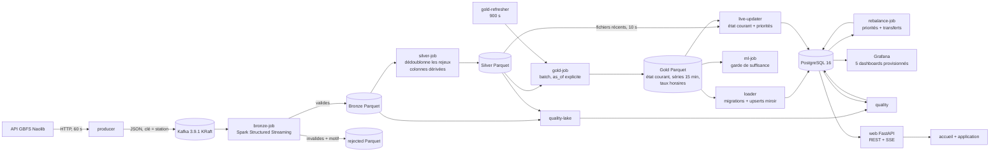
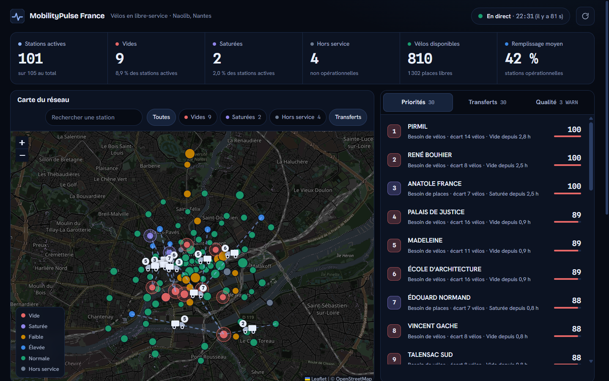
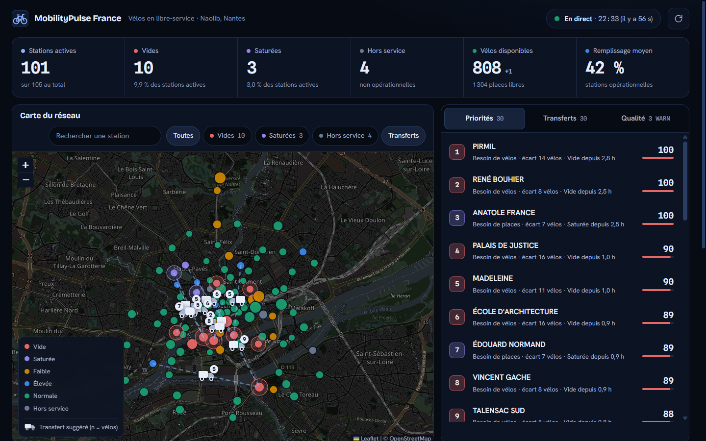
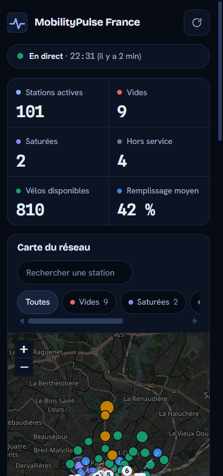
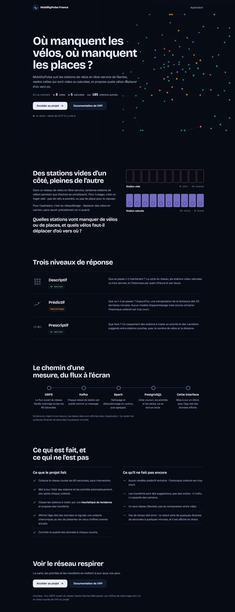
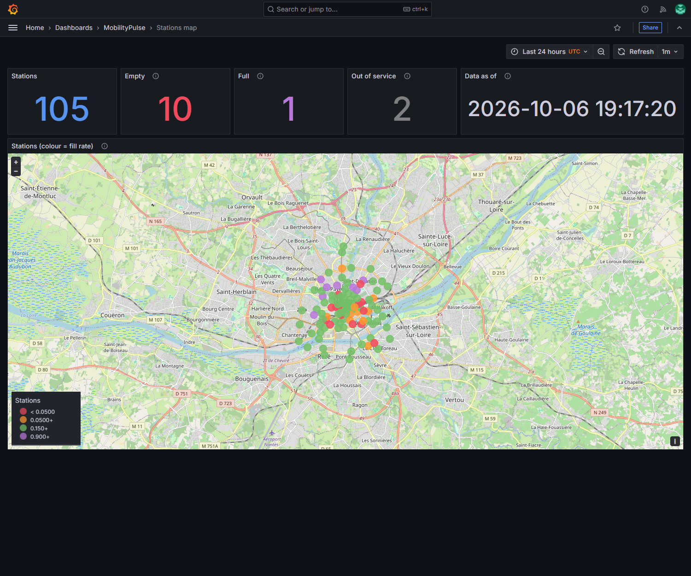
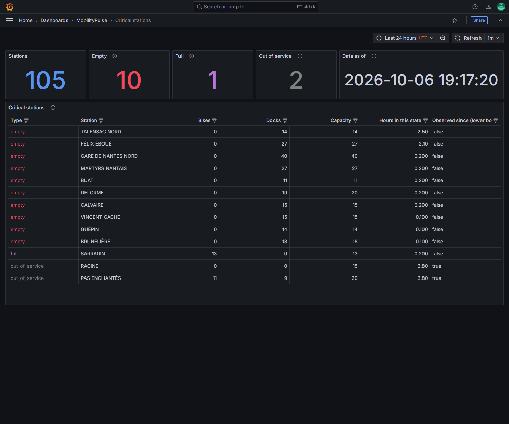
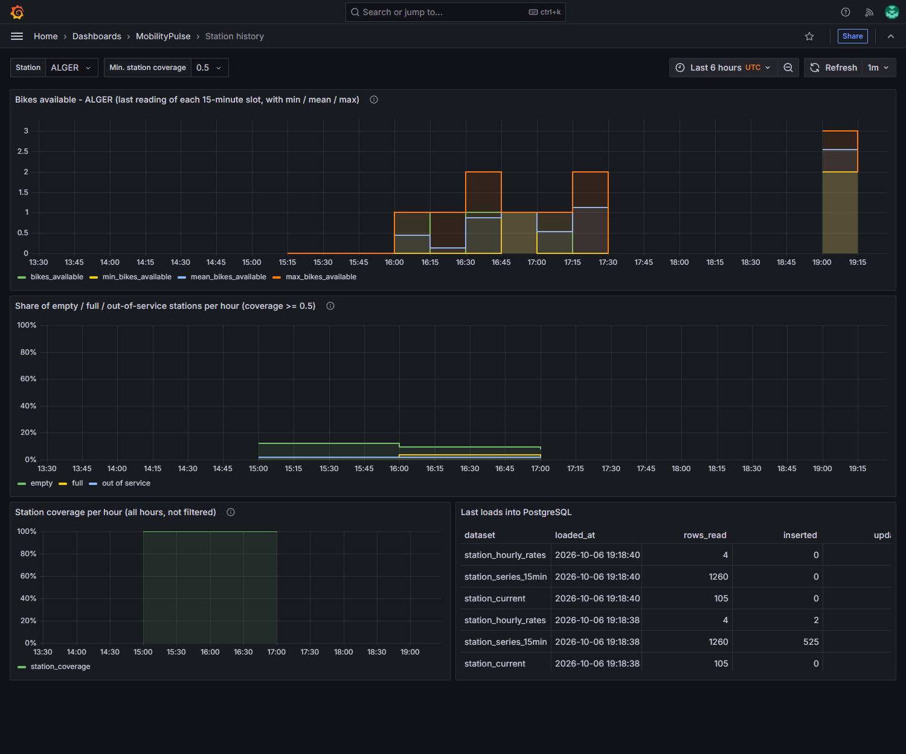
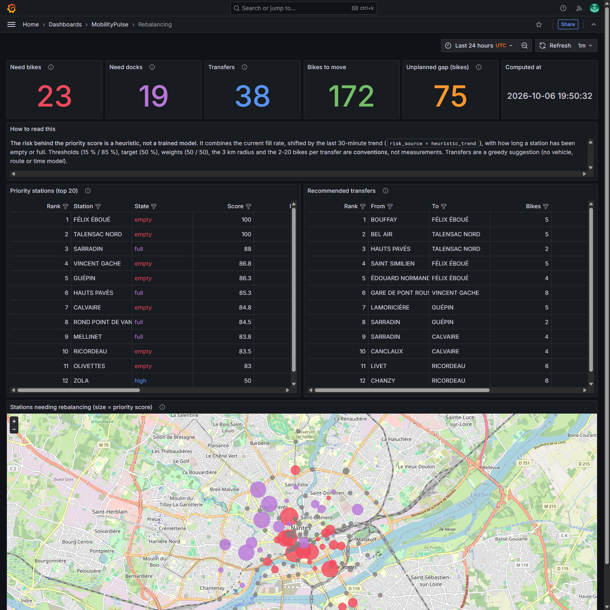
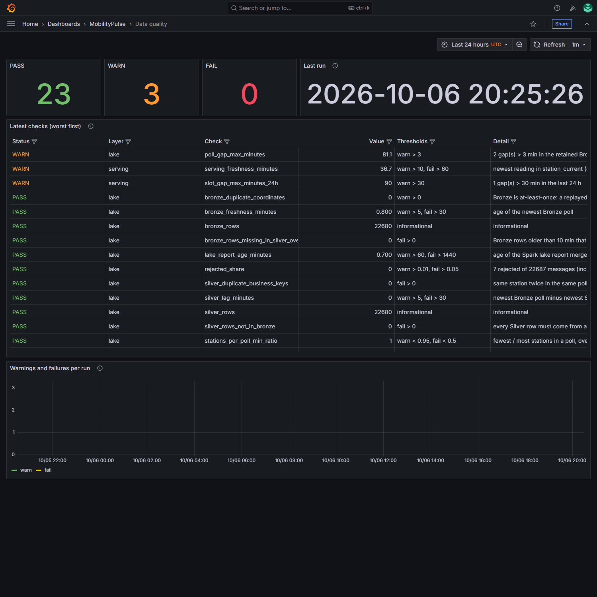

# MobilityPulse France

Plateforme de données pour le vélopartage de Nantes (Naolib) : collecte en continu de l'état de
105 stations, nettoyage et agrégation en couches Bronze / Silver / Gold, service dans PostgreSQL,
une interface web mise à jour en direct (accueil + application), des tableaux de bord Grafana, et
premières briques d'aide à la décision (risque, rééquilibrage).

> **Lecture honnête de l'état du projet.** La chaîne de données (collecte → Grafana) fonctionne et
> est vérifiée par des recalculs indépendants. En revanche : **il n'existe pas encore de modèle
> prédictif fiable** (l'historique sain est trop court), et les recommandations de rééquilibrage
> reposent sur une **heuristique**, pas sur un modèle. L'interface n'est pas du temps réel strict :
> le retard mesuré est de l'ordre de 40 s à 100 s (médiane 77 s) (voir « Résultats mesurés »), et elle affiche
> l'âge réel des données. Voir « Décisions et limites ».

## Le problème métier

Un opérateur de vélos en libre-service doit savoir, station par station, où il n'y a plus de vélos
(usagers bloqués) et où il n'y a plus de bornes libres (retours impossibles), puis où déplacer des
vélos. Le flux GBFS public donne l'état instantané de chaque station ; le garder dans le temps
permet de mesurer la pénurie et la saturation, d'envisager de les prévoir, et de proposer des
rééquilibrages.

## Où en est chaque couche

| Couche | État | Preuve |
|---|---|---|
| Collecte (producteur → Kafka KRaft) | fonctionne | 105 stations toutes les 60 s, depuis le 6 octobre 2026 vers 15h28 UTC |
| Bronze (Spark Structured Streaming) | fonctionne | tout est conservé, y compris les messages invalides (table des rejets avec motif) |
| Silver | fonctionne | un relevé par station et par poll ; 0 écart avec Bronze dans les deux sens |
| Gold (agrégats descriptifs) | fonctionne | 9 contrôles par recalcul indépendant en Python pur |
| PostgreSQL + Grafana | fonctionne | chargement idempotent et atomique ; 5 dashboards ; copie vérifiée contre les Parquet |
| Prédictif | **code prêt, aucun modèle** | `insufficient_data` : 0 échantillon d'entraînement (historique trop court) |
| Prescriptif | fonctionne, **risque heuristique** | contrôles SQL indépendants ; utilité des transferts **non mesurée** |
| Mise à jour automatique | fonctionne | `live-updater` (état courant, priorités) et `gold-refresher` (séries, taux horaires) ; aucun lancement manuel ; panne de PostgreSQL simulée puis reprise seule |
| Interface web (accueil + application, flux SSE) | fonctionne | délai mesuré poll → navigateur ; fraîcheur et cause d'un retard affichées ; mode mouvement réduit |
| Qualité des données | fonctionne | 26 contrôles aux seuils explicites, historisés et affichés |
| Intégration continue | fonctionne | exécutée sur GitHub le 8 octobre 2026 : les 4 jobs passent (voir plus bas) |

## Architecture



Services en continu : `kafka`, `producer`, `spark-master`, `spark-worker`, `bronze-job`,
`silver-job`, `postgres`, `grafana`, `web`, `live-updater`, `gold-refresher`. Jobs à la demande
(profil `tools`) : `compact-bronze`, `gold-job`, `loader`, `ml-job`, `rebalance-job`,
`quality-lake`, `quality`. Conception détaillée :
[docs/architecture.md](docs/architecture.md).

## Captures de l'interface (données réelles du 7 octobre 2026)

| | |
|---|---|
|  |  |
| *Accueil : le réseau réel dessiné en fond, chiffres lus dans l'API* | *Application : carte, priorités, transferts (camions), indicateurs* |
|  |  |
| *Accueil sur mobile (375 px)* | *Application sur mobile (375 px)* |



*Accueil en entier. Captures prises en mode « mouvement réduit », qui montre l'état final sans
animation.* Pour la panne de base de données : `docs/img/state-db-down.png`.

## Captures Grafana (données réelles du 6 octobre 2026)

| | |
|---|---|
|  |  |
| *Carte : état courant des 105 stations* | *Stations vides, saturées ou hors service* |
|  |  |
| *Historique d'une station ; la coupure de collecte apparaît comme un trou* | *Priorités et transferts (risque heuristique)* |



*Qualité des données : 23 PASS, 3 WARN (coupure de collecte, retard de la couche de service), 0 FAIL.*

## Stack et versions

Kafka 3.9.1 (KRaft) · Spark / PySpark 3.5.7 (Java 17) · Python 3.11 · PostgreSQL 16.4 · Grafana
11.3.0 · psycopg 3.2.3 · pyarrow 17.0.0 · numpy 1.26.4 (MLlib) · pytest 8.4.2 · ruff 0.13.3.
Stockage local en Parquet (montage `./data`), pas de stockage objet.

## Démarrer

```powershell
cp .env.example .env     # puis remplacer les 3 "change-me" par de vrais mots de passe aléatoires
docker compose up -d --build
# Accueil : http://localhost:18000      Application : http://localhost:18000/app
# Grafana : http://localhost:13000
```

Plus rien à lancer à la main pour voir le réseau : `live-updater` applique les migrations, rattrape
les fichiers Silver récents puis suit les nouveaux, et `gold-refresher` recalcule les agrégats lourds
toutes les 15 minutes. Les premières minutes, l'interface dit honnêtement qu'il n'y a pas encore de
données ou qu'elles sont en retard.

L'interface web (`src/web/`, service `web`) est en lecture seule : une API FastAPI interroge
PostgreSQL avec le rôle `grafana_ro` (requêtes fixes, aucune SQL construite à partir de l'entrée
utilisateur), pousse les changements aux navigateurs par SSE (`/api/stream`, repli en polling) et
sert l'accueil et l'application. Elle affiche l'âge réel des données et, si elles sont en retard,
la cause (collecte interrompue, mise à jour arrêtée, base indisponible). Les fonds de carte viennent
d'OpenStreetMap (Internet requis pour la carte seulement). `PROJECT_REPO_URL` (facultatif, dans
`.env`) ajoute un lien « Code source et README » sur l'accueil.

Prérequis, toutes les commandes, la procédure de vérification pas à pas, le diagnostic des incidents
et les problèmes fréquents (Windows / WSL2) : **[docs/runbook.md](docs/runbook.md)**.
Aucun secret n'est stocké hors de `.env` (ignoré par git) ; Compose refuse de démarrer sans eux.

## Démo en ligne (portfolio)

Le projet complet (Kafka, Spark, PostgreSQL) a besoin d'un serveur : il ne peut pas tourner sur
GitHub Pages. Pour un portfolio, `scripts/build_demo.py` en fait une **démo figée** : un site statique
qui lit une photographie des données réelles (`demo/data`, environ 1 Mo, prise avec
`scripts/export_demo.py`) au lieu de l'API. La carte, les camions, les priorités, les transferts et
les graphiques fonctionnent ; le flux en direct et les pannes ne sont pas démontrables. Tous les
textes qui parleraient de direct sont remplacés par « Démo figée : données du … » : **la démo ne se
présente jamais comme du temps réel.** Les chemins sont relatifs, le site marche donc sous
`https://<utilisateur>.github.io/<dépôt>/` comme à la racine d'un domaine.

```powershell
python scripts/export_demo.py                    # photographie (la pile doit tourner, avec des données)
python scripts/build_demo.py --repo-url https://github.com/<utilisateur>/<dépôt>
```

Publication (GitHub Pages, Render ou tout hébergeur statique), vérification sous un sous-chemin et
mise à jour : [docs/runbook.md](docs/runbook.md#publier-la-démo-figée). Le workflow
`.github/workflows/pages.yml` publie à chaque push de `main`. Premier lancement le 8 octobre 2026 :
la construction du site réussit sur un runner Ubuntu, la publication reste bloquée tant que Pages
n'est pas activé dans les réglages du dépôt (Source : GitHub Actions).

## Résultats mesurés (6 octobre 2026)

| Mesure | Valeur |
|---|---|
| Collecte | 216 polls × 105 stations = 22 680 relevés au 20h25 UTC ; **81 min d'interruption** (arrêt de Docker) + un trou de 4,5 min au démarrage |
| Silver vs Bronze | identiques, 0 doublon, 0 ligne orpheline |
| Rejets | 7 messages invalides **injectés volontairement** pour tester la tolérance (0,03 % du total) |
| Gold | 9 contrôles de recalcul indépendant : tous `PASS` |
| PostgreSQL | idempotent (2e chargement : 0 insertion, 0 mise à jour, 0 suppression) ; 9 agrégats identiques aux Parquet |
| Prédictif | `insufficient_data` : 420 échantillons, **0 pour l'entraînement** (seuil 500), 14 débuts d'épisode en test (seuil 30) |
| Rééquilibrage | 23 stations manquent de vélos, 19 de bornes ; 38 transferts, 172 vélos déplacés ; 75 vélos de besoin non couverts |
| Rééquilibrage, contrôles SQL | distances recalculées en SQL (écart max 5·10⁻⁷ km), 0 violation de surplus ou de besoin, 0 station hors service utilisée |
| Qualité | 23 PASS, 3 WARN, 0 FAIL (voir ci-dessous) |

### Temps réel et interface (7 octobre 2026)

| Mesure | Valeur |
|---|---|
| Délai poll → réception sur le flux SSE (19 polls, 19 min) | min 40,8 s · **médiane 76,9 s** · p95 100,6 s · max 104,0 s |
| Délai poll → affichage dans le navigateur (2 polls) | 76,9 s et 58,5 s |
| Ce qui fait varier ce délai | ~41 s machine au calme, 52 à 104 s quand un calcul Gold, des tests et des installations tournent en même temps ; `silver-job` prend alors du retard (24 alertes « falling behind » en 25 min) |
| Un cycle du `live-updater` | 0,47 s en régime établi (3,9 s au démarrage) |
| Calcul Gold (`gold-refresher`) | 146 s au calme, 308 s machine chargée ; pic mémoire 678 Mio |
| Mémoire des 11 services | environ 2,7 Gio au repos, environ 3,3 Gio pendant un calcul Gold (VM Docker : 8,2 Go) |
| Chiffres à l'écran | identiques à ceux de l'API (101 stations actives, 11 vides, 6 saturées, 4 hors service, 826 vélos, 42 %) |
| Panne de PostgreSQL simulée (arrêt propre) | l'application affiche « Base de données indisponible », l'accueil masque ses chiffres ; reprise sans redémarrer `live-updater` |

Ces mesures viennent d'une seule fenêtre de 19 minutes, sur une machine de développement : ce sont
des constats, pas un benchmark. Méthode et commandes : [docs/runbook.md](docs/runbook.md#vérifier-le-temps-réel).

**Aucune performance prédictive n'est annoncée** : il n'y a pas de modèle entraîné. Les tests
d'entraînement utilisent un réseau **synthétique** et ne vérifient que la mécanique.

## Qualité des données

Deux suites, des seuils **explicites** (des conventions, pas des mesures), un verdict
PASS / WARN / FAIL par contrôle, historisé dans PostgreSQL (`data_quality_results`) et affiché dans
Grafana. Un contrôle qui ne peut pas être calculé est un WARN, jamais un PASS silencieux.

- **Lac** (`quality-lake`, Spark) : Silver ⊆ Bronze, lignes Bronze jamais produites par Silver,
  doublons de coordonnées Kafka et de clé métier, part de rejets, stations par poll, plus grand trou
  de collecte, fraîcheur de Bronze, retard de Silver.
- **Service** (`quality`, PostgreSQL) : fraîcheur, stations qui ne remontent plus, complétude des
  créneaux, compteurs physiquement impossibles, cohérence horaire / séries, âge du dernier
  chargement, alignement et intégrité des recommandations, parts de stations vides ou hors service,
  créneaux datés du futur.

Exécution réelle du 6 octobre à 20h25 UTC (sans rafraîchir les données au préalable) : 23 PASS, 3 WARN,
0 FAIL. Les trois WARN sont de vrais constats : le trou de collecte de 81 min vu du lac, ses 90 min
dans les créneaux de PostgreSQL, et **36,7 min de retard de la couche de service sur le lac**
(Gold et le chargeur n'avaient pas été relancés). Les seuils n'ont pas été réglés pour obtenir du
vert.

## Intégration continue

`.github/workflows/ci.yml` : quatre jobs sur chaque `push` vers `main` et chaque pull request.

| Job | Contenu |
|---|---|
| `lint-and-unit` | `ruff check`, `ruff format --check`, tests sans Java ni base (pages, flux, scripts du front avec `node`) |
| `spark-tests` | Java 17 + PySpark : Bronze, Silver, Gold, ML, qualité du lac ; **aucun test ignoré toléré** |
| `postgres-tests` | PostgreSQL 16 avec mot de passe jetable généré à l'exécution ; migrations, chargeur, rééquilibrage, qualité, mise à jour en direct, API et flux SSE (vrai serveur uvicorn) ; au moins 170 tests, 1 seul ignoré |
| `compose-config` | `docker-compose.yml` valide, profil `tools` compris |

Deux garde-fous évitent un vert trompeur : en CI (`CI_REQUIRE_SERVICES=1`) un service absent fait
**échouer** les tests au lieu de les ignorer, et `scripts/ci_assert_skips.py` échoue si trop de tests
sont ignorés ou si trop peu ont tourné.

**Ce qui est vérifié, et ce qui ne l'est pas.** Le workflow a tourné pour la première fois sur
GitHub Actions le 8 octobre 2026, au premier push : **les 4 jobs ont réussi** (`lint-and-unit` 19 s,
`compose-config` 7 s, `postgres-tests` 43 s, `spark-tests` 81 s), ce qui valide aussi l'installation de
Java par `actions/setup-java` et les versions d'actions utilisées. Avant cela, il avait été validé
statiquement avec `actionlint` (aucune alerte), et ses commandes **rejouées localement** : le job `lint-and-unit` dans un environnement
Python vierge (installation, lint, tests), le job `postgres-tests` contre la vraie base (c'est ce
rejeu qui a révélé une liste de migrations oubliée dans un test), les fichiers du job `spark-tests`
dans le conteneur Spark (38 tests, 0 ignoré), et la résolution des dépendances Spark à blanc.
Après l'ajout de l'interface, le job `postgres-tests` a été rejoué dans un environnement virtuel
vierge avec ses dépendances (`.[dev,loader,web]`) et sa liste de tests : 190 réussis, 1 ignoré
(la comparaison avec PySpark), 191 au total, contrôle d'`assert_skips` réussi ; `actionlint` n'a
signalé aucune alerte sur le workflow modifié.
Ces durées viennent d'une seule exécution. Un seul run a eu lieu : la stabilité d'un run à l'autre
(tests dépendant du temps, du réseau) n'est pas mesurée.

## Décisions et limites

### Décisions structurantes

- **Médaillon Bronze / Silver / Gold en Parquet.** Bronze garde tout (rejets compris), ce qui permet
  de reconstruire Silver et Gold : c'est ce qui a permis de corriger deux incidents sans perte.
- **Silver ne supprime que les rejeux de livraison**, jamais un changement d'état. Le champ
  `last_reported` du flux n'est pas rafraîchi quand les compteurs changent (1016 changements de
  compteurs entre relevés consécutifs, dont 14 avec un nouveau `last_reported`) : le temps d'un
  relevé est l'heure du poll.
- **Gold en batch avec une heure de référence explicite** (`as_of`) : déterministe, rejouable,
  testable. Aucun état n'est reporté d'un créneau à l'autre, et une période sans relevé reste un
  trou.
- **PostgreSQL pour servir** : migrations versionnées (checksum), upserts idempotents en miroir
  dans une seule transaction, contraintes `CHECK`, rôle Grafana en lecture seule. Dashboards
  provisionnés par fichiers, non modifiables depuis l'interface.
- **Pas de modèle tant que les données ne le permettent pas** : le job ML refuse d'entraîner sous
  des seuils explicites et publie les comptes et les raisons. Le risque du rééquilibrage est une
  heuristique **étiquetée comme telle** (`risk_source`).
- **Vérifier par un recalcul indépendant** (Python pur pour Gold, SQL pour les distances et les
  quantités) plutôt que de faire confiance au code qu'on teste : c'est ainsi qu'ont été trouvés un
  arrondi au demi-pair et deux défauts d'affichage Grafana.

### Erreurs commises, corrigées, documentées

1. **Dédoublonnage Silver sur `last_reported`** (mon implémentation de la spécification) : il
   supprimait ~99 % des vrais changements, et Gold, PostgreSQL et Grafana montraient un réseau
   figé. Détecté en mesurant dans Bronze ; tout a été refait.
2. **Checkpoints Spark corrompus** par un arrêt brutal de Docker (fichiers pleins de zéros) : 81 min
   de collecte perdues, Bronze réparé sans perte ni doublon après vérification, Silver reconstruit.
   La procédure est dans le runbook.
3. **Chargeur sans suppression** : l'upsert seul aurait laissé en base les lignes erronées d'avant
   la correction. Le chargeur recopie désormais Gold en miroir.
4. **Arrondi** (`round` de Python au demi-pair) dans la cible de rééquilibrage, trouvé par un
   contrôle SQL indépendant.

### Limites connues

- **Historique très court** : relevés sains depuis le 6 octobre 2026 vers 15h28 UTC seulement, et
  rien d'antérieur ne peut être reconstitué honnêtement depuis ce flux. D'où l'absence de modèle.
- **Utilité des recommandations non mesurée** : pas de vérité terrain ni de simulation d'impact ;
  seuils et poids non calibrés ; appariement glouton sans véhicules, itinéraires ni durées ; l'écart
  non couvert (75 vélos) n'a pas été analysé.
- **Automatique pour l'état courant, pas pour tout** : `live-updater` et `gold-refresher` alimentent
  PostgreSQL seuls ; qualité, ML et compaction restent à lancer à la main. L'interface **affiche**
  une collecte interrompue (fraîcheur et cause), mais aucune **alerte** ne prévient quelqu'un qui ne
  la regarde pas.
- **Silver est le goulot du délai** : il liste environ 530 petits fichiers de Bronze à chaque
  déclenchement (31 à 68 s mesurées) et prend du retard sur son déclencheur de 30 s. La compaction de
  Bronze l'allégerait ; elle n'a pas été lancée (elle supprime des fichiers, c'est une décision à
  prendre).
- **Livraison at-least-once** (pas exactly-once) : un crash en plein batch pourrait doubler des
  lignes dans Bronze (absorbées par Silver) ; ce cas précis n'a pas été testé.
- **Mono-nœud et échelle de développement** : un seul broker (réplication 1, sans authentification),
  Silver en `local[2]`, Gold relit tout Silver, le chargeur lit tout en mémoire, stockage local.
- **Dépendance à une source publique** : si l'API est indisponible, rien n'est rattrapé.
- **Heures en UTC** (seules les variables de calendrier du modèle sont en heure de Paris) ; fond de
  carte OpenStreetMap soumis à Internet et à la politique d'usage des tuiles.
- **Compaction Bronze** non coordonnée avec Silver (se fie à l'âge des fichiers) ; une
  reconstruction de Silver ignorerait des fichiers compactés.
- **Linux natif non testé** ; **mémoire** : mesurée le 7 octobre 2026 sur les 11 services
  (voir « Résultats mesurés »), un instantané et non un benchmark.
- **Marge mémoire faible sur la machine de développement** : VM Docker de 7,8 Gio, 2,8 Gio
  disponibles et swap plein le 7 octobre 2026 (avec d'autres projets en parallèle). Un calcul Gold a
  échoué pendant des tests et a été repris seul ; la suite Spark doit se lancer fichier par fichier
  (runbook).
- **Interface** : testée dans Chromium (Playwright) à 1440 et 375 px, pas sur un vrai téléphone ;
  fluidité des animations non mesurée en images par seconde ; un seul diffuseur SSE par process
  (50 clients au plus).

La liste exhaustive est dans [docs/architecture.md](docs/architecture.md#limites-connues).

## Structure du dépôt

```
src/common/       configuration (variables d'environnement), journaux JSON
src/producer/     GBFS -> Kafka (+ injection de messages invalides)
src/streaming/    Bronze, Silver, Gold, compaction, inspections
src/loader/       migrations SQL versionnées, chargement Gold -> PostgreSQL
src/live/         mise à jour en direct : suivi des fichiers Silver, état par station, battement
src/web/          API FastAPI (REST, /api/status, /api/stream SSE) + front statique (css/, js/, fonts/)
src/ml/           échantillons, découpage chronologique, entraînement, garde de suffisance
src/prescriptive/ score de priorité, transferts (haversine), job
src/quality/      contrôles de qualité (lac et service)
sql/migrations/   schéma PostgreSQL versionné (001 à 006)
grafana/          datasource et 5 dashboards provisionnés
tests/            unitaires, Spark, intégration PostgreSQL, fixtures GBFS
scripts/          contrôle des tests ignorés (CI), mesure de la latence du flux, export et
                  construction de la démo figée
demo/data/        photographie des données pour la démo figée (commitée)
docs/             architecture, runbook, pitch d'entretien, captures
PRODUCT.md        contexte produit (utilisateurs, principes)
DESIGN.md         système visuel de l'interface
.github/workflows CI
```

## Documentation

- [docs/runbook.md](docs/runbook.md) : commandes, procédure de vérification, incident type,
  problèmes fréquents.
- [docs/architecture.md](docs/architecture.md) : conception détaillée, chemin temps réel et flux SSE,
  versions, limites.
- [DESIGN.md](DESIGN.md) et [PRODUCT.md](PRODUCT.md) : système visuel et contexte produit de
  l'interface.
- [docs/pitch.md](docs/pitch.md) : présenter le projet en entretien (ce qu'on peut affirmer, et ce
  qu'il ne faut pas).
