# Architecture - phases 1 à 7 et chantier « temps réel + interface » (A à D)

## Diagramme

```mermaid
flowchart LR
    API[API GBFS Naolib<br/>station_information + station_status] -->|HTTP, 60 s| P[producer<br/>Python 3.11]
    FIX[(tests/fixtures/gbfs)] -.->|GBFS_FIXTURE_DIR| P
    P -->|clé = station_id<br/>JSON| K[(Kafka 3.9.1 KRaft<br/>gbfs.station_status.v1<br/>3 partitions, RF 1)]
    K --> J[bronze-job<br/>Spark Structured Streaming 3.5.7<br/>foreachBatch, trigger 30 s]
    J -->|valides| B[(data/bronze/station_status<br/>partition ingestion_date)]
    J -->|invalides + reject_reason| R[(data/rejected/station_status<br/>partition rejection_date)]
    J -.-> C[(data/checkpoints/bronze_station_status)]
    M[spark-master] --- W[spark-worker<br/>1 coeur, 1 Go] --- J
    B -->|lecture fichiers part-*| S[silver-job<br/>Spark local 2 coeurs<br/>dedup rejeux + colonnes dérivées]
    S --> SV[(data/silver/station_status<br/>un relevé par station et par poll<br/>partition ingestion_date)]
    S -.-> SC[(data/checkpoints/silver_station_status)]
    CB[compact-bronze<br/>batch à la demande] -->|part-* → compacted-*<br/>jours clos| B
    SV --> G[gold-job<br/>batch à la demande, as_of explicite]
    G --> G1[(gold/station_current)]
    G --> G2[(gold/station_series_15min<br/>partition slot_date)]
    G2 --> G3[(gold/station_hourly_rates<br/>partition hour_date)]
    G1 & G2 & G3 --> L[loader<br/>batch à la demande<br/>migrations + upserts miroir]
    L --> PG[(PostgreSQL 16.4<br/>schéma mobility)]
    PG -->|rôle lecture seule grafana_ro| GR[Grafana 11.3<br/>3 dashboards provisionnés]
    G2 --> ML[ml-job<br/>batch à la demande<br/>échantillons + split temporel + régression logistique]
    ML --> MT[(data/ml/training_set)]
    ML --> MR[(data/ml/reports/latest.json)]
    ML -.->|seulement si données suffisantes| MM[(data/ml/models)]
    PG --> RB[rebalance-job<br/>batch à la demande<br/>risque heuristique + haversine]
    RB --> PR[(rebalancing_priority<br/>rebalancing_transfers)]
    PR --> GR
    B & SV --> QL[quality-lake<br/>Spark, contrôles du lac]
    QL -->|data/quality/lake_latest.json| QS[quality<br/>contrôles de service + fusion]
    PG --> QS
    QS --> DQ[(data_quality_results<br/>v_data_quality_latest)]
    DQ --> GR
    SV -->|nouveaux fichiers, toutes les 10 s| LU[live-updater<br/>Python, un process léger<br/>état courant + priorités]
    LU -->|upsert idempotent + battement<br/>pipeline_status| PG
    GF[gold-refresher<br/>un process par cycle, 900 s] -->|lance| G
    G2 & G3 -->|nouveaux fichiers Gold| LU
    PG -->|lecture seule grafana_ro| WEB[web FastAPI<br/>REST + /api/status + /api/stream]
    WEB -->|SSE, repli en polling 30 s| UI[navigateur<br/>accueil / et application /app]
```

## Flux de données

1. **Producer** : lit `station_information` (statique : nom, coordonnées, capacité ; rafraîchi toutes
   les `STATION_INFO_REFRESH_SECONDS`) et `station_status` (dynamique), les fusionne en un événement
   par station et publie en JSON, clé = `station_id`. Les enregistrements invalides côté source sont
   écartés et journalisés avant publication. Toutes les stations d'un même poll partagent le même
   `ingestion_timestamp` (heure du poll).
2. **Kafka** : un nœud KRaft (broker + contrôleur), création automatique de topics désactivée ; le
   topic est créé par `kafka-init`. Deux listeners : `INTERNAL` (kafka:9092, conteneurs) et
   `EXTERNAL` (localhost:39092, hôte).
3. **bronze-job** : lit Kafka (`startingOffsets=earliest` seulement au premier lancement),
   `from_json` avec un schéma Spark explicite, applique des règles de validation, puis écrit :
   - **Bronze** : événements valides + métadonnées Kafka (`topic`, `partition`, `offset`,
     `timestamp`, clé) + `bronze_ingested_at`, partitionné par `ingestion_date` ;
   - **rejected** : payload brut, `reject_reason` et métadonnées Kafka, partitionné par
     `rejection_date`.
4. **Règles de rejet** (première règle échouée retenue) : `invalid_json`, `missing_required_field`,
   `blank_station_id`, `negative_availability`, `invalid_coordinates`,
   `invalid_event_timestamp`, `invalid_ingestion_timestamp`. Un champ de mauvais type
   (ex. `"many"` dans un entier) devient `null` à la lecture et ressort donc comme
   `missing_required_field`, sans motif spécifique.

## Le champ `event_timestamp` n'est pas l'heure des compteurs

C'est la leçon la plus importante du projet, apprise à nos dépens. Le champ `last_reported` du flux
GBFS (conservé sous le nom `event_timestamp`) **n'est pas rafraîchi quand les compteurs changent**.
Mesuré sur Bronze (non dédoublonné), le 6 octobre 2026 : sur 7875 paires de relevés consécutifs
d'une même station, les compteurs de vélos changent 1016 fois, mais `event_timestamp` ne change que
17 fois (14 en même temps qu'un changement de compteur) : **1002 changements de compteurs se sont
produits sous un `event_timestamp` inchangé**.

Conséquences, et correction (phases 2 à 4 refaites) :
- l'heure d'un relevé est l'heure du poll, `ingestion_timestamp` (exposée comme `observed_at` en
  Silver) ; `event_timestamp` reste disponible tel que reçu mais ne sert plus d'axe de temps ;
- Silver ne dédoublonne plus sur `(source, station_id, event_timestamp)` (ce qui supprimait ~99 %
  des changements réels) mais sur `(source, station_id, ingestion_timestamp)`, qui ne détecte que
  deux copies du même relevé ;
- Gold est calculé sur les relevés observés, sans report d'état d'un créneau à l'autre.

Avant la correction, le Gold et les dashboards affichaient une vue quasi figée du réseau (par ex.
des stations « vides depuis 15 h »). Ces affichages étaient faux ; les captures d'écran et les
chiffres de cette documentation ont été refaits depuis.

## Silver (phase 2, corrigée)

**Lecture** : flux de fichiers sur `data/bronze/station_status`, schéma explicite
(`BRONZE_SCHEMA`), filtre `pathGlobFilter=part-*`, `maxFilesPerTrigger=50`.

**Contenu** : un relevé par station et par poll (≈ 105 lignes par minute ici, soit de l'ordre de
150 000 lignes par jour : petit). Rien n'est supprimé qui ne soit un doublon de livraison.

**Dédoublonnage** (`streaming/silver.py`), deux `dropDuplicatesWithinWatermark` successifs :
1. `(kafka_topic, kafka_partition, kafka_offset)` : même message Kafka lu deux fois (batch Bronze
   rejoué après un crash, fichier relu) ;
2. `(source, station_id, ingestion_timestamp)` : la même station livrée deux fois pour un même poll.

Le watermark porte sur `ingestion_timestamp` (heure d'arrivée) ; l'état du dédoublonnage reste borné
par `SILVER_WATERMARK_DELAY` (24 h par défaut). Contrepartie : un doublon arrivant plus de 24 h après
sa première copie est conservé.

**Colonnes dérivées** : `fill_rate = num_bikes_available / capacity` (nul si la capacité est nulle
ou absente), `is_empty` (0 vélo), `is_full` (0 borne libre), `is_operational`
(installée ET location ET retour actifs), `observed_at` (= `ingestion_timestamp`). `is_empty` et
`is_full` décrivent seulement les compteurs : une station hors service à 0 vélo reste `is_empty`,
à combiner avec `is_operational`. `fill_rate` n'est pas borné à 1. Les colonnes Bronze (dont les
métadonnées Kafka et `event_timestamp`) sont conservées, plus `silver_processed_at`.

**Écriture** : sink Parquet natif de Structured Streaming (journal `_spark_metadata`), mode
append, partitionné par `ingestion_date` (date de `observed_at`), checkpoint séparé
(`data/checkpoints/silver_station_status`). Lire Silver avec Spark (`spark.read.parquet`) respecte
ce journal ; une lecture directe des fichiers ne le fait pas.

**Reconstruction** : Silver se reconstruit depuis Bronze en supprimant `data/silver/station_status` et
`data/checkpoints/silver_station_status` puis en redémarrant `silver-job` (fait le 6 octobre 2026).
Attention : Silver ne lit que `part-*`. Des fichiers `compacted-*` (jours clos compactés) seraient
ignorés par une reconstruction : il faudrait alors élargir le filtre.

**Exécution** : en mode `local[2]` et non sur le cluster : l'unique cœur du worker est occupé par
`bronze-job`, et une seconde application y resterait en attente de ressources.

## Compaction Bronze

`streaming/compact_bronze.py`, job batch lancé à la demande. Il ne traite que les partitions
`ingestion_date` antérieures à aujourd'hui (UTC), dont aucun fichier n'a été modifié depuis
10 minutes (option `--min-age-seconds`), pour que Silver les ait déjà consommées. Il fusionne les
`part-*` en un seul `compacted-<hash>.snappy.parquet`, vérifie que le nombre de lignes est
identique, puis supprime les sources. Le nom est déterministe : après un crash entre l'écriture et
la suppression, la relance réutilise le fichier produit au lieu d'en créer un second.

Le nommage fait le lien avec Silver : Silver ne lit que `part-*`, donc ne relit jamais les
fichiers compactés. Les lecteurs batch (`spark.read.parquet`) voient, eux, tous les fichiers.

## Gold descriptif (phase 3, refait)

Le job (`streaming/gold_job.py`) lit Silver avec le schéma explicite `SILVER_SCHEMA`, calcule tout
relativement à un `as_of` explicite (par défaut l'heure courante, UTC ; `--as-of` pour reproduire un
calcul) et écrit trois jeux de données, chacun avec un schéma de sortie déclaré dans `schemas.py`.
**L'axe de temps est `observed_at` (heure du poll).** Avec un relevé par minute et par station, un
créneau de 15 min contient ses propres relevés : rien n'est reporté d'un créneau à l'autre, et un
créneau sans relevé (pipeline arrêté) n'a pas de ligne.

| Jeu de données | Contenu | Écriture |
|---|---|---|
| `gold/station_current` | Dernier relevé de chaque station avant `as_of` : état, `observed_at`, `last_reported_at` (champ du flux, informatif), `first_observed_at`, `last_change_at`, `minutes_since_observed`, `hours_in_current_state`, `state_age_is_lower_bound`. | Écrasement complet. |
| `gold/station_series_15min` | Une ligne par station et par créneau de 15 min contenant au moins un relevé : état du dernier relevé du créneau, `min/mean/max_bikes_available`, `n_readings`, `n_changes`, `is_complete`. | Partitionné par `slot_date`, écrasement dynamique des partitions recalculées. |
| `gold/station_hourly_rates` | Par source et par heure : `empty_rate`, `full_rate`, `non_operational_rate`, `stations_observed`, `station_coverage`, `is_complete`. | Partitionné par `hour_date`, écrasement dynamique. |

**Définitions.**
- Un changement (`changed`) = un relevé dont l'un des compteurs ou indicateurs (`capacity`, vélos,
  bornes, vélos/bornes hors service, `is_installed`, `is_renting`, `is_returning`) diffère du relevé
  précédent de la station (comparaison sûre vis-à-vis de `null`) ; le premier relevé n'est pas un
  changement.
- `hours_in_current_state` compte depuis le dernier changement **observé**. Si aucun changement n'a
  été observé, il compte depuis la première observation et `state_age_is_lower_bound` vaut vrai :
  la station est peut-être dans cet état depuis plus longtemps, mais on ne la surveillait pas.
- Unité d'observation des taux horaires : une station à la fin d'un créneau de 15 min.
- `empty_rate` et `full_rate` n'incluent que les stations opérationnelles (dénominateur :
  `operational_observations`) ; `non_operational_rate` est la part de stations hors service.
  Ils sont nuls si aucune station n'est opérationnelle.
- `station_coverage` = stations ayant au moins un créneau dans l'heure / stations vues dans la
  fenêtre. Elle baisse quand le pipeline était arrêté ou la première heure est partielle : les taux
  des heures à faible couverture ne décrivent qu'une partie du réseau.
- Le créneau contenant `as_of` (et l'heure correspondante) est marqué `is_complete = false`.
- Les séries couvrent les `GOLD_SERIES_DAYS` derniers jours (7 par défaut, début arrondi à l'heure).
  Chaque exécution recalcule cette fenêtre ; les partitions plus anciennes ne sont pas modifiées.

**Historique réel disponible.** Les relevés sains n'existent que depuis le démarrage du pipeline
(≈ 15 h 25 UTC le 6 octobre 2026). Gold ne peut pas remonter plus loin : avant cette date, il n'y a
pas de relevé, et reconstituer un état à partir de `last_reported` est précisément l'erreur
décrite plus haut.

**Vérification.** `streaming/inspect_gold.py` recalcule en Python pur, depuis Silver collecté sur le
driver, l'état courant (dernier relevé, dernier changement, âge de l'état), le nombre de créneaux,
et pour chaque créneau `n_readings`, `n_changes` et le dernier nombre de vélos, puis compare avec les
Parquet Gold (9 contrôles, tous `PASS` le 6 octobre 2026 : 9135 relevés et 1153 changements dans la
fenêtre). Utilisable tel quel seulement sur un jeu de développement.

## PostgreSQL et Grafana (phase 4)

**Schéma SQL versionné** (`sql/migrations/`). Fichiers `NNN_description.sql`, appliqués dans l'ordre
par `loader/migrations.py` et enregistrés dans `<schéma>.schema_migrations` avec leur checksum
SHA-256. Une migration déjà appliquée dont le fichier a changé, ou disparue du disque, fait échouer
le chargeur : on ajoute une nouvelle migration au lieu de modifier l'ancienne. Un verrou
consultatif sérialise deux exécutions simultanées. Le nom du schéma est un paramètre
(`{{schema}}`, validé comme identifiant) : les tests d'intégration travaillent dans un schéma
jetable. La migration `003` recrée `station_current` et `station_series_15min`, vide
`station_hourly_rates` et ajoute `load_log.deleted` : c'est la correction de la sémantique Gold
(Gold étant dérivé et rechargeable, son ancien contenu erroné est jeté, pas migré).

| Objet | Rôle |
|---|---|
| `station_current` (PK source, station_id) | Copie de `gold/station_current`. |
| `station_series_15min` (PK source, station_id, slot_start) | Copie de la série 15 min. |
| `station_hourly_rates` (PK source, hour_start) | Copie des taux horaires, avec `station_coverage`. |
| `load_log` | Une ligne par table et par chargement : lues / insérées / mises à jour / inchangées / supprimées. |
| `v_station_state` (vue) | Pour Grafana : `critical_type` ∈ `empty`, `full`, `out_of_service` ou nul. |

Contraintes `CHECK` (compteurs ≥ 0, taux dans [0, 1], coordonnées valides) : une donnée impossible
fait échouer tout le chargement plutôt que d'entrer en base.

**Upserts idempotents, puis miroir.** Pour chaque table : `COPY` vers une table temporaire, puis
`INSERT … ON CONFLICT (clé) DO UPDATE … WHERE (colonnes) IS DISTINCT FROM (nouvelles valeurs)`.
Une ligne identique n'est donc ni réécrite ni horodatée (`updated_at` inchangé). Ensuite, les lignes
que Gold ne contient plus (dans la plage de temps chargée, option `--days` comprise) sont supprimées :
une correction de Gold ne peut plus laisser de lignes périmées en base (le défaut qui aurait
conservé les anciennes lignes erronées). Un jeu de données Gold **vide** ne supprime rien : cela
ressemble davantage à un job en échec qu'à un réseau sans station. Les trois tables sont chargées
dans **une seule transaction** : tout ou rien. Les doublons de clé dans l'entrée sont rejetés
explicitement. Les horodatages Parquet sans fuseau sont lus comme de l'UTC.

**Chargeur en Python** (psycopg 3 + pyarrow, image sans JVM) plutôt qu'en JDBC Spark : le JDBC de
Spark ne sait qu'ajouter ou écraser, pas faire d'upsert. Les jeux de données sont lus entièrement en
mémoire : adapté à cette échelle seulement.

**Secrets.** Les trois mots de passe (`POSTGRES_PASSWORD`, `GRAFANA_DB_PASSWORD`,
`GRAFANA_ADMIN_PASSWORD`) viennent uniquement de `.env` ; Compose refuse de démarrer si l'un est
absent ou vide (vérifié). Les fichiers versionnés n'en contiennent aucun (un test le contrôle :
seuls `change-me` ou une référence `$VARIABLE` sont acceptés). Le rôle Grafana `grafana_ro` est créé
par le chargeur avec `SELECT` seul sur le schéma ; `PostgresSettings` n'affiche jamais les mots
de passe dans son `repr`.

**Grafana provisionné par fichiers** (`grafana/provisioning/`, `grafana/dashboards/`) : datasource
`MobilityPulse` (identifiants lus dans l'environnement du conteneur), dossier `MobilityPulse`, trois
dashboards non modifiables depuis l'interface :
- *Stations map* : carte (géocouche markers, fond OpenStreetMap), couleur selon le taux de
  remplissage, compteurs vides / saturées / hors service, heure de référence du dernier Gold.
- *Critical stations* : tableau des stations vides, saturées ou hors service, avec « Hours in this
  state » et une case « Observed since (lower bound) » quand aucun changement n'a été observé.
- *Station history* : série 15 min d'une station (variable : dernier relevé, min, moyenne, max du
  créneau), taux horaires, couverture, derniers chargements. Le panneau des taux horaires masque par
  défaut les heures à `station_coverage` < 0,95 (variable réglable) ; le panneau de couverture, lui,
  n'est pas filtré.

**Vérifications faites** : les requêtes de tous les panneaux renvoient des données via l'API
Grafana ; le contrôle visuel dans un navigateur a trouvé deux défauts que l'API ne montrait pas
(panneau « Data as of » vide : un `stat` ne réduit pas une colonne timestamp ; fond de carte Carto
par défaut devenu payant), corrigés. Neuf agrégats comparés entre Parquet et PostgreSQL étaient
identiques (avant la correction de sémantique, qu'aucun de ces contrôles ne pouvait détecter : ils
vérifiaient la fidélité de la copie, pas la justesse de la logique).

## Prédictif (phase 5)

**Question.** Une station sera-t-elle opérationnelle et vide ou saturée dans 30 minutes ?
(`label_critical_30min`.)

**Échantillons** (`ml/features.py`) : une ligne par station et par créneau complet `t` de
`gold/station_series_15min`. Variables : vélos à `t`, `t-15`, `t-30`, `t-60`, capacité, taux de
remplissage, état opérationnel, état critique à `t`, heure locale et jour de la semaine
(`Europe/Paris`). L'étiquette est l'état du créneau `t+30`. Un échantillon n'existe que si **tous**
ces créneaux sont présents : rien n'est interpolé ni reporté. Les créneaux incomplets, et les
stations sans capacité connue, sont écartés. Test de non-fuite : modifier tous les créneaux après `t`
ne change aucune variable de l'échantillon, seulement son étiquette.

**Découpage chronologique, jamais aléatoire** (`temporal_split`) : les 30 % derniers créneaux
distincts forment le test (`slot_start >= coupure`). L'entraînement ne garde que les échantillons dont
le créneau d'étiquette est entièrement terminé avant la coupure : aucune étiquette d'entraînement ne
regarde dans la période de test (un embargo coûte donc quelques échantillons).

**Références (baselines)** : *persistance* (« critique dans 30 min » = « critique maintenant ») et
*toujours négatif*. Les métriques sont calculées sur tous les échantillons de test et sur les
**débuts d'épisode** (stations non critiques à `t` qui le sont à `t+30`), le seul cas que la
persistance ne peut jamais anticiper.

**Modèle** : régression logistique MLlib (variables standardisées, classes pondérées pour équilibrer
la perte, `regParam = 0,01`). Métriques : précision, rappel, F1 au seuil 0,5, PR-AUC et ROC-AUC,
toutes calculées par `ml/evaluate.py` à partir des prédictions, jamais écrites à la main.

**Garde de suffisance des données** (`ml/guards.py`) : le job n'entraîne et ne publie aucune métrique
de modèle tant que les seuils suivants ne sont pas atteints (conventions explicites, configurables,
non des constats mesurés) : ≥ 500 échantillons d'entraînement, ≥ 30 positifs d'entraînement, ≥ 30
positifs de test et ≥ 30 débuts d'épisode en test, avec les deux classes présentes dans le test. Sinon
le rapport `data/ml/reports/latest.json` donne `status: insufficient_data`, les comptes et les
raisons, et aucun modèle n'est écrit. `--force` entraîne quand même pour vérifier la mécanique : le
rapport porte alors `reliable: false` et `status: trained_unreliable_forced`, et aucun modèle n'est
sauvegardé.

**Honnêteté sur les données réelles.** Voir « Résultat réel » dans le README : au moment de la
livraison de la phase, l'historique sain est de quelques heures, bien en deçà des seuils. Les tests
d'entraînement utilisent un réseau **synthétique** pour vérifier le code (le modèle bat la persistance
sur les débuts d'épisode d'un motif appris par construction) ; ces chiffres ne sont **pas** une
performance.

## Prescriptif (phase 6)

**Le risque n'est pas prédit par un modèle.** La phase 5 n'a pas assez d'historique, donc le score
repose sur une heuristique transparente (`prescriptive/scoring.py`), étiquetée
`risk_source = heuristic_trend` sur chaque ligne : une probabilité de modèle pourra la remplacer
sans ambiguïté. Tous les seuils et poids ci-dessous sont des **conventions** configurables
(`Params`), validées à la construction, et n'ont pas été calibrés.

**Entrées** : `station_current` et la série 15 min déjà chargées dans PostgreSQL (le même état que
celui affiché par Grafana). La tendance est la variation du taux de remplissage entre le dernier
créneau complet et celui de 30 min avant ; elle est ignorée si ce créneau a plus de 45 min de retard
sur `as_of` (pipeline arrêté). **Garde de fraîcheur** : le job refuse de calculer (code 3) si le
dernier relevé a plus de 30 min, sauf `--force`.

**États** : `empty` (0 vélo), `full` (0 borne), `low` (< 15 %), `high` (> 85 %), `ok`,
`out_of_service`, `unknown_capacity`. Les deux derniers ne sont ni receveurs ni donneurs.

**Score de priorité** (0-100) = 100 × (0,5 × urgence + 0,5 × criticité) :
- urgence = écart du taux projeté (taux actuel + tendance, borné à [0, 1]) à la bande 15 %-85 %,
  normalisé : 1 pour une station projetée vide ou saturée, 0 dans la bande ;
- criticité = 0 sauf station vide ou saturée maintenant, alors 0,6 + 0,4 × min(heures dans l'état / 2, 1).

**Besoins** (état courant uniquement, jamais la projection) : vide ou basse = manque de vélos
(écart = cible − vélos) ; pleine ou haute = manque de bornes (écart = vélos − cible). La cible est
50 % de la capacité **arrondie à la hausse** (10,5 → 11). Python arrondit les moitiés à l'entier
pair ; ce défaut a été trouvé par un contrôle SQL indépendant (voir README).

**Transferts** (`prescriptive/matching.py`) : appariement glouton. Les receveurs sont servis par
priorité décroissante. Pour chacun, les donneurs (station à ≥ 60 % avec surplus ≥ 2 vélos) sont
triés : ceux qui manquent eux-mêmes de bornes d'abord (un transfert règle alors deux problèmes), puis
distance haversine croissante (rayon 3 km). Quantité = min(écart restant, surplus du donneur,
20) ; sous 2 vélos, pas de transfert. Un donneur ne donne jamais plus que son surplus restant, une
paire (donneur, receveur) n'apparaît qu'une fois, et le résultat est déterministe (égalités
départagées par identifiant). La liste est numérotée par priorité du receveur puis distance.

**Sorties PostgreSQL** (migration `004`, contraintes `CHECK`) : `rebalancing_priority` (une ligne par
station : état, score, urgence, criticité, besoin, vélos prévus en entrée / sortie, écart non couvert,
`risk_source`) et `rebalancing_transfers` (donneur, receveur, vélos, distance, rang). Écriture en
miroir, dans **une seule vraie transaction** qui englobe aussi les lectures : un test a montré que
des lectures préalables rendaient l'écriture imbriquée (point de sauvegarde), et qu'un `rollback`
annulait alors tout.

**Grafana** : dashboard *Rebalancing* (compteurs, avertissement « heuristique, pas un modèle »,
tables des priorités et des transferts, carte colorée par besoin et dimensionnée par priorité).

**Vérifications** : 18 tests purs (haversine, scores calculés à la main, appariement, déterminisme),
7 tests d'intégration contre PostgreSQL (dont une distance recalculée en SQL, la fraîcheur, la
transaction, l'idempotence, les contraintes), et un contrôle SQL indépendant sur les sorties réelles
(10 vérifications, voir README).

## Qualité des données (phase 7)

**Principe.** Chaque contrôle mesure **un nombre** et le compare à des seuils explicites ; les
seuils sont des **conventions** (ce que l'on juge inquiétant), écrites à côté de chaque contrôle et
stockées dans la colonne `threshold` des résultats. Verdict : `PASS`, `WARN` ou `FAIL`
(`quality/core.py`, logique pure testée sur l'hôte). Un contrôle qui ne peut pas être calculé (aucune
ligne, requête en erreur) est un `WARN` qui porte la raison, jamais un `PASS` silencieux.

**Deux suites, deux jobs.**
- *Lac* (`quality/lake_checks.py`, image Spark, `quality-lake`) : Silver ⊆ Bronze ; lignes Bronze de
  plus de 10 min jamais produites par Silver ; doublons de coordonnées Kafka (`WARN`, Bronze est
  at-least-once) et de clé métier `(source, station_id, ingestion_timestamp)` ; part de rejets ;
  stations par poll ; plus grand trou de collecte ; fraîcheur de Bronze ; retard de Silver. Écrit
  `data/quality/lake_latest.json`.
- *Service* (`quality/serving_checks.py`, image du chargeur, `quality`) : 14 contrôles SQL sur
  PostgreSQL (fraîcheur, stations qui ne remontent plus, complétude des créneaux, compteurs
  physiquement impossibles, cohérence horaire / séries, âge du dernier chargement, alignement et
  intégrité des recommandations, parts de stations vides ou hors service, créneaux futurs). Fusionne
  le rapport du lac, en contrôlant son âge, puis stocke tout sous un `run_id` unique.

**Un trou de collecte passé est un WARN, une collecte arrêtée maintenant est un FAIL.** Le plus grand
trou de l'historique ne dépasse jamais le niveau `WARN` (le pipeline peut être revenu en bonne
santé) ; seule la fraîcheur actuelle peut passer en `FAIL`.

**Conception.** Les fonctions de contrôle renvoient `(valeur, détail)` ; un registre `SPECS` porte le
nom et les seuils. Ainsi un contrôle qui plante est publié **sous son vrai nom** (un test l'a révélé :
le nom de la fonction diffère du nom du contrôle, ce qui aurait décalé l'historique Grafana).
Chaque contrôle s'exécute dans un point de sauvegarde : une requête en erreur n'empoisonne pas les
autres.

**Persistance.** Table `data_quality_results` et vue `v_data_quality_latest` (migration `005`),
purge au-delà de 30 jours, code de sortie non nul si un contrôle est en `FAIL`. Dashboard Grafana
*Data quality* (compteurs, tableau classé par gravité, historique par passage).

**Exécution réelle** (6 octobre 2026, 20h25 UTC, sans rafraîchir les données) : 23 `PASS`, 3 `WARN`,
0 `FAIL`. WARN : trou de collecte de 81 min (lac) et de 90 min (créneaux PostgreSQL), et 36,7 min de
retard de la couche de service sur le lac. Les seuils n'ont pas été ajustés pour obtenir du vert.

**Limites.** Seuils non calibrés ; les deux jobs se lancent à la main, dans l'ordre (le service lit
un fichier JSON écrit par le lac, d'où le contrôle d'âge) ; un seul passage dans l'historique au
moment de la capture (le graphique d'historique ne trace rien avec un seul point) ; pas de contrôle
de dérive statistique des valeurs ni de schéma côté lac au-delà des schémas Spark explicites.

## Intégration continue (phase 7)

`.github/workflows/ci.yml`, sur `push` vers `main` et sur pull request, permissions minimales
(`contents: read`), annulation des exécutions obsolètes :

| Job | Contenu |
|---|---|
| `lint-and-unit` | Python 3.11, `ruff check`, `ruff format --check`, `pytest` sans Java ni base |
| `spark-tests` | Java 17 (Temurin) + `.[dev,spark]` : tests Spark, Gold, ML, qualité du lac ; `CI_REQUIRE_SERVICES=1` ; 0 test ignoré toléré |
| `postgres-tests` | PostgreSQL 16.4 lancé avec un mot de passe **généré à l'exécution et masqué** ; migrations, chargeur, rééquilibrage, qualité ; 1 test ignoré toléré (la comparaison chargeur / schémas Spark, qui exige PySpark) |
| `compose-config` | `docker compose config` avec `.env.example`, profil `tools` compris |

**Garde-fous contre un vert trompeur.** `tests/helpers.py::skip_or_fail` fait **échouer** un test
dont le service manque quand `CI_REQUIRE_SERVICES=1` (au lieu de l'ignorer), et
`scripts/ci_assert_skips.py` lit le rapport JUnit et échoue si trop de tests sont ignorés ou trop
peu ont tourné (script lui-même testé).

**Validation faite ici** : `actionlint` (aucune alerte) ; `lint-and-unit` rejoué dans un
environnement Python vierge ; `postgres-tests` rejoué contre la vraie base (il a trouvé une liste de
migrations oubliée dans un test) et vérifié en mode CI **avec la base injoignable** (les tests
échouent, ils ne sont pas ignorés) ; les cinq fichiers de `spark-tests` rejoués dans le conteneur
(38 tests, 0 ignoré) ; résolution des dépendances `.[dev,spark]` à blanc.
**Non vérifié** : l'exécution sur GitHub (le dépôt n'y est pas), l'installation de Java par
`actions/setup-java`, la disponibilité et le comportement des versions majeures d'actions
(`checkout@v4`, `setup-python@v5`, `setup-java@v4`), la durée sur les runners hébergés.

## Chemin temps réel et interface (chantier A à D)

Objectif : que l'interface reflète le réseau avec un retard de l'ordre de la minute **sans lancer
quoi que ce soit à la main**, et qu'elle dise la vérité quand ce n'est pas le cas.

### Ce qui limitait le délai (mesuré le 7 octobre 2026)

| Étape | Durée mesurée |
|---|---|
| Poll → publié dans Kafka | 0,0 s (le producteur publie pendant le poll) |
| Poll → écrit dans Bronze | min 3,7 s, médiane 4,5 s, p95 42,9 s (4 polls : petit échantillon) |
| Poll → écrit dans Silver | médiane 14,4 s, p95 73,1 s (même échantillon) |
| `gold-job` lancé avec `docker compose run` | 130,3 s (démarrage JVM + session 4,2 s ; lecture et comptage de Silver, 53 025 lignes : 57,5 s puis 49,8 s ; `run_gold` à chaud : 114,3 s et 104,9 s) |
| `loader` | 3,8 s |
| `rebalance-job` | 1,7 s |

La cause n'est ni le démarrage de la JVM ni le calcul : ce sont **1 436 petits fichiers Parquet**
dans Silver (9,5 Ko en moyenne, 13,3 Mo au total, environ 700 de plus par jour) lus à travers le
montage Windows, et Gold relit Silver deux fois (état courant, séries).

### Deux options comparées

| | (a) boucle `gold-job` + `loader` + `rebalance-job` | (b) chemin court Silver → PostgreSQL pour `station_current` |
|---|---|---|
| Délai plancher | environ 2 min 20 s par cycle (130 + 4 + 2 s), **croissant** avec les fichiers de Silver | quelques secondes après l'écriture d'un fichier Silver |
| Mémoire | JVM Spark (jusqu'à environ 1 Go) à chaque cycle, ou résidente | un process Python (mesuré 73 Mio) |
| Reste vrai | séries 15 min et taux horaires (agrégats lourds) | seulement l'état courant et les priorités |

**Décision : hybride.** Le chemin court (b) porte l'état courant et les priorités ; la boucle (a),
allégée en un process par cycle de 900 s, porte les agrégats lourds, hors du chemin critique.

### Composants

- **`live-updater`** (`src/live/`, image du chargeur). Toutes les `LIVE_INTERVAL_SECONDS` (10 s) :
  liste les nouveaux fichiers `part-*.parquet` de Silver, les lit, applique les relevés à l'état par
  station et fait un upsert dans `station_current`. Même sémantique que Gold : un changement est un
  écart sur capacité, vélos, bornes, disponibilités désactivées ou drapeaux de service ; le premier
  relevé d'une station n'est pas un changement ; le temps est l'heure du poll (`observed_at`), jamais
  `last_reported`. Les relevés sont appliqués dans l'ordre `(observed_at, offset Kafka)` et un relevé
  non plus récent que la ligne stockée est ignoré : rejouer des fichiers est sans effet. Il met aussi à
  jour `as_of`, `minutes_since_observed` et `hours_in_current_state` pour toutes les stations, supprime
  les stations absentes depuis 24 h, relance le rééquilibrage (avec sa garde de fraîcheur de 30 min)
  quand un relevé nouveau est arrivé, et charge les séries et taux horaires quand `gold-refresher` a
  écrit de nouveaux fichiers (jamais `station_current`, qui lui appartient). Il écrit un battement dans
  `pipeline_status` à chaque cycle.
- **Lecture efficace de Silver.** `stat` coûte environ 4,5 ms par fichier sur le montage Windows
  (1 500 fichiers : environ 7 s). Les partitions plus anciennes que la fenêtre ne sont pas visitées,
  les fichiers déjà vus ou trop vieux sont mémorisés, et un fichier n'est lu qu'après 2 s sans
  modification. Un cycle mesuré dure **0,47 s** une fois ces mémoires remplies (3,9 s au démarrage,
  contre environ 10 s avant la mémorisation).
- **`gold-refresher`** : `streaming.gold_refresher` relance `gold_job` dans un process distinct, puis
  attend `GOLD_REFRESH_SECONDS` (900 s) après la fin du calcul. Aucune JVM ne reste entre deux cycles ;
  un `SIGTERM` arrête le calcul en cours et empêche tout nouveau cycle (`docker compose stop` propre).
- **Migration 006** : table `pipeline_status` (battements, détail du dernier cycle) et les drapeaux de
  service `is_installed`, `is_renting`, `is_returning` dans `station_current`, pour reconnaître un
  changement après un redémarrage.
- **API** (`src/web/app.py`) : `/api/status` (fraîcheur, cause, coupures de plus de 30 min sur 24 h ;
  répond même si PostgreSQL est tombé), `/api/stream` (SSE), `/api/overview` enrichi, `/api/config`
  (lien optionnel `PROJECT_REPO_URL`). Toutes les requêtes sont fixes et paramétrées, avec le rôle
  `grafana_ro` en lecture seule.
- **Flux SSE** (`web/stream.py`) : un seul lecteur partagé interroge la base toutes les
  `STREAM_POLL_SECONDS` (2 s) **seulement tant qu'un client écoute**, et envoie un `snapshot` complet
  au premier message, puis des `update` ne contenant que les stations modifiées (et les listes de
  priorités ou de transferts seulement si elles ont changé) ; rien n'est envoyé quand rien ne change.
  Les files par client sont bornées : un client trop lent est resynchronisé par un nouvel instantané.
  Au plus 50 clients simultanés. Le navigateur se reconnecte seul ; s'il ne peut pas, l'interface
  bascule en polling toutes les 30 s.
- **Interface** (`src/web/static/`) : accueil `/` et application `/app`, thème partagé
  (`css/tokens.css`), polices auto-hébergées. Voir `DESIGN.md`.

### Dire la vérité sur la fraîcheur

L'âge est mesuré sur `observed_at` : `live` jusqu'à 150 s, `delayed` jusqu'à 600 s, `stale` au-delà.
Quand ce n'est pas `live`, la cause vient du battement du `live-updater` : battement récent mais pas
de relevé nouveau = **collecte interrompue** (producteur, Kafka, Bronze ou Silver) ; battement
absent depuis plus de 60 s = **mise à jour arrêtée** ; battement présent avec une erreur = **erreur de
la mise à jour**. Aucune donnée en base = `no_data`. La panne de PostgreSQL est un état à part :
`/api/status` répond quand même (`database_unavailable`), le flux envoie un événement `status` une
seule fois, puis un instantané complet au retour de la base.

| Situation | Ce que voit l'utilisateur |
|---|---|
| Base indisponible | Bandeau « Base de données indisponible » ; les chiffres affichés sont les derniers reçus ; l'accueil masque ses chiffres |
| Flux GBFS ou collecte arrêtés | Pastille « Données en retard / périmées », bandeau avec la cause |
| `live-updater` arrêté ou en erreur | Idem, avec la cause correspondante |
| Flux SSE perdu, API joignable | Bascule en polling 30 s, notification |
| API injoignable | « Hors ligne » et bandeau ; aucun chiffre présenté comme actuel |
| Coupure de collecte passée | Listée par `/api/status` (`gaps`) et visible comme trou dans les graphiques |

### Mesures (7 octobre 2026)

Latence du poll à l'arrivée sur le flux (`scripts/measure_sse_latency.py`, même machine, donc sans
dérive d'horloge ; le rendu à l'écran, de l'ordre de la milliseconde, n'est pas inclus) :

| Mesure | Valeur |
|---|---|
| Échantillons | 19 polls consécutifs, 19 minutes (19h42 à 20h01 UTC) |
| Minimum | 40,8 s |
| Médiane | 76,9 s |
| p95 | 100,6 s |
| Maximum | 104,0 s |
| Vu depuis le navigateur (heure du poll → changement de l'heure affichée), 2 polls | 76,9 s et 58,5 s |

Lecture honnête : les trois premiers polls, machine au calme, ont été livrés en **environ 41 s**.
Ensuite le délai est monté à 52–104 s et y est resté, y compris après la fin du calcul Gold : pendant
la mesure, un calcul Gold (19h45 à 19h51), l'installation d'un environnement Python, des tests et un
téléchargement d'image Docker ont tourné sur la même machine, et `silver-job` a signalé 24 fois
« Current batch is falling behind » en 25 minutes (ses lots durent plus que son déclencheur de 30 s),
si bien que le retard s'accumule plutôt qu'il ne se résorbe. L'objectif « moins d'environ 2 minutes »
est tenu dans cette mesure (maximum 104 s), mais avec peu de marge, et **la charge de la machine
déplace le délai de 40 s à 100 s**. Ce n'est qu'une fenêtre de 19 minutes.

Mémoire (`docker stats`, trois échantillons espacés de 40 s, collecte en continu, hors calcul Gold) :

| Service | Mémoire | Limite |
|---|---|---|
| silver-job | 707 Mio | 1 Gio |
| bronze-job | 584 Mio | 1,5 Gio |
| spark-worker | 545 Mio | 2 Gio |
| kafka | 337 Mio | 1 Gio |
| grafana | 130 Mio | 512 Mio |
| gold-refresher (au repos) | 104 Mio | 1 Gio |
| spark-master | 92 Mio | 768 Mio |
| live-updater | 73 Mio | 192 Mio |
| postgres | 71 Mio | 512 Mio |
| web | 54 Mio | 256 Mio |
| producer | 24 Mio | 256 Mio |
| **Total** | **environ 2,7 Gio** | |

Pendant un calcul Gold, `gold-refresher` monte à **678 Mio** (limite 1 Gio), soit environ 3,3 Gio au total (somme du tableau avec ce pic à la place de ses 104 Mio de repos). Ce calcul a duré 146 s à 19h29 (machine au calme) et 308 s à 19h45 (machine chargée). La VM Docker dispose de 8,2 Go (`docker info`) ; elle héberge aussi d'autres conteneurs
de la machine, que ce projet ne touche pas.

### Limites propres à ce chemin

- **Silver reste le goulot.** Il liste environ 530 fichiers de Bronze à chaque déclenchement
  (31 à 68 s mesurées sur le montage Windows) et ses lots durent 60 à 130 s pour un déclencheur de
  30 s : il prend du retard, et l'âge des données oscille autour du seuil `live`. La compaction de
  Bronze (jours clos seulement) réduirait ce nombre ; elle n'a pas été lancée.
- **Fichiers Silver : environ 700 de plus par jour** ; la lecture de la fenêtre récente n'en
  dépend pas, mais `gold-refresher`, lui, relit tout Silver.
- **Un seul diffuseur SSE par process** (un seul worker uvicorn) : pas de montée en charge
  horizontale ; 50 clients au plus.
- **Au premier redémarrage après un chargement Gold sans drapeaux** (colonnes nulles), une station
  hors service peut afficher un « changement » factice, ce qui remet son ancienneté à zéro.
- **Pas d'alerte** : l'état est affiché, pas notifié hors de l'interface.
- **Marge mémoire faible** : le 7 octobre 2026 la VM Docker (7,8 Gio) n'avait plus que 2,8 Gio
  disponibles et son swap était plein ; un calcul Gold a échoué (`Cannot allocate memory`) pendant
  une suite de tests, et il a été repris au cycle suivant. Détails dans le runbook.

## Décisions de versions

| Composant | Version | Remarque |
|---|---|---|
| Kafka | 3.9.1 (`apache/kafka`) | Mode KRaft, pas de ZooKeeper. |
| PySpark / Spark | 3.5.7 | Distribution Spark fournie par le paquet pip `pyspark`. |
| Python | 3.11 | Identique dans l'image producteur, l'image Spark et l'hôte (`requires-python >=3.11,<3.12`), pour éviter les écarts de sérialisation PySpark. |
| Java | 17 (JRE headless) | Spark 3.5 exige Java 8/11/17 ; le test Spark est ignoré si Java 11/17 est absent. |
| Connecteur Kafka | `spark-sql-kafka-0-10_2.12` 3.5.7, `kafka-clients` 3.4.1, `commons-pool2` 2.11.1 | JAR téléchargés dans l'image (`docker/spark.Dockerfile`). |
| numpy | 1.26.4 | Requis par `pyspark.ml` ; version 1.x comme PySpark 3.5 l'attend. |
| Client producteur | `confluent-kafka` 2.11.1 | |
| Outils dev | `pytest` 8.4.2, `ruff` 0.13.3 | Versions épinglées dans `pyproject.toml`. |
| PostgreSQL | 16.4 (`postgres:16.4-alpine`) | |
| Grafana | 11.3.0 (`grafana-oss`) | Le type de datasource `postgres` y est migré vers `grafana-postgresql-datasource`. |
| Chargeur | `psycopg[binary]` 3.2.3, `pyarrow` 17.0.0 | Image `docker/loader.Dockerfile`, Python 3.11. |

Une seule image Spark sert le master, le worker, le driver Bronze, Silver, Gold et le job ML. Le
producteur et le chargeur ont leur propre image légère.

## Ports et ressources

Ports hôte : Kafka 39092, UI master 18080, UI worker 18081, UI driver Bronze 14040, UI Silver 14041,
PostgreSQL 15432, Grafana 13000, **web 18000** (les ports par défaut 8080/8081/29092 sont déjà pris
sur la machine de développement).

Limites mémoire déclarées dans `docker-compose.yml` : kafka 1 Go, spark-master 768 Mo, spark-worker
2 Go, bronze-job 1,5 Go, silver-job 1 Go, producer 256 Mo, postgres 512 Mo, grafana 512 Mo, web
256 Mo, live-updater 192 Mo, gold-refresher 1 Go (les jobs à la demande `compact-bronze`, `gold-job` :
1 Go, `ml-job` et `quality-lake` : 1,5 Go, `loader` : 512 Mo, `rebalance-job` et `quality` : 256 Mo,
uniquement pendant leur exécution). Mesures réelles des 11 services en continu : voir « Mesures »
dans la section précédente. Ce ne sont que des instantanés, pas un benchmark.

## Incident du 6 octobre 2026 (checkpoints et interruption de collecte)

Un arrêt brutal de Docker Desktop a laissé 22 fichiers entièrement nuls dans le checkpoint et le
journal du sink de Silver, et `commits/133` nul dans le checkpoint de Bronze : les deux jobs
redémarraient en boucle. Aucune donnée n'a été perdue dans Kafka. Bronze a été réparé après avoir
vérifié que son batch 133 était complet (105 lignes sur 105 attendues, offsets contigus) : validé
sans doublon, puis rattrapage de 1155 lignes. Silver a été reconstruit depuis Bronze (15 540 lignes
des deux côtés, 0 écart). La collecte, elle, a bien été interrompue **81 minutes** (producteur
arrêté avec Docker) : cette période n'a aucun relevé, et aucun n'est inventé. Procédure complète dans
le README.

Conséquences durables :
- les séries Gold ont un trou de 81 min ; les dashboards l'affichent comme une rupture de ligne (une
  grille de créneaux avec jointure à gauche produit des `NULL`), pas comme un segment plat ;
- `hours_in_current_state` est mesuré en temps réel écoulé et **traverse** ce trou : un état n'a pas
  été observé en continu pendant ces 81 minutes ;
- les échantillons ML exigent des créneaux contigus : l'interruption les fragmente encore.

## Limites connues

- **Historique très court.** Les relevés sains n'existent que depuis le démarrage du pipeline. Tout
  ce qui demande de l'historique (profils horaires, saisonnalité, modèle prédictif) est limité par
  cela, et aucune donnée antérieure ne peut être reconstituée honnêtement depuis ce flux.
- **`last_reported` inutilisable comme heure des compteurs** (voir la section dédiée) : toute
  nouvelle source de temps doit être validée par une mesure comme celle décrite plus haut.
- **At-least-once, pas exactly-once.** `foreachBatch` écrit en `append` puis le checkpoint est
  validé. Un crash entre les deux rejouerait le batch et créerait des doublons dans Bronze.
  Lors de notre test, un redémarrage propre (`docker compose restart`, SIGTERM) n'a produit
  **aucun** doublon. Le cas d'un crash en plein batch n'a **pas** été testé. La déduplication sur
  `(kafka_topic, kafka_partition, kafka_offset)` en Silver absorbe ces rejeux.
- **Petits fichiers** : un fichier Parquet par batch non vide (`coalesce(1)`, toutes les 30 s
  quand le producteur publie). La compaction ne traite que les jours clos : **la partition du jour
  reste en petits fichiers** jusqu'au lendemain. Silver écrit aussi des fichiers par micro-batch.
- **Compaction non coordonnée avec Silver** : elle se fie à l'âge des fichiers (10 min par défaut),
  pas à l'état réel du checkpoint Silver. Si Silver est arrêté plus longtemps, il faut le
  rattraper avant de compacter. Pendant la compaction, un lecteur batch peut voir brièvement les
  lignes en double (fichier compacté présent avant la suppression des sources). Une reconstruction
  de Silver ignorerait les fichiers compactés (voir Silver).
- **Silver sur un seul processus** (`local[2]`) : pas de scalabilité horizontale pour ce job.
- **Gold relit tout Silver** : `gold-refresher` le relance toutes les 900 s (un process par cycle),
  mais chaque calcul relit Silver en entier (environ 2 min) : acceptable à cette échelle, pas au-delà.
- **Latence Silver et heure de référence de Gold** : Silver a jusqu'à environ une minute de retard
  sur le producteur (déclencheurs de 30 s de Bronze puis de Silver). Gold utilise l'heure courante
  comme `as_of` : le dernier poll n'est donc pas toujours dans Gold, et le contrôle `inspect_gold`
  se limite aux relevés que Gold a pu voir (sinon il échoue à tort, ce qui s'est produit).
- **Pas d'alerte active si la collecte s'arrête** : l'interface l'affiche (fraîcheur et cause) mais
  rien ne prévient quelqu'un qui ne la regarde pas.
- **Gold et lecteurs concurrents** : l'écrasement de partition n'est pas atomique ; un lecteur
  pendant l'écriture peut voir un état intermédiaire.
- **Changement de schéma Gold** : l'écrasement dynamique ne réécrit que les partitions de la
  fenêtre ; une partition plus ancienne garderait l'ancien schéma. La correction de sémantique a été
  appliquée en supprimant les anciens jeux Gold (dérivés) avant de les recalculer.
- **Fuseau** : Silver, Gold et PostgreSQL sont en UTC ; les heures et jours sont des heures et jours
  UTC. Seules les variables de calendrier du modèle (`hour_local`, `day_of_week_local`) sont en heure
  de `Europe/Paris`.
- **Gold à Grafana** : `live-updater` et `gold-refresher` alimentent PostgreSQL seuls ; les
  dashboards montrent le dernier chargement, d'où le panneau « Data as of ». Qualité, ML et
  compaction restent à lancer à la main.
- **Chargeur** : lecture intégrale en mémoire, un seul schéma cible, pas de retour arrière des
  migrations (pas de « down »).
- **Grafana** : un seul `source` supposé dans la variable `station` du dashboard d'historique (la
  clé de station y est `station_id` seul) ; fond de carte OpenStreetMap soumis à la politique
  d'usage des tuiles et à l'accès Internet ; mot de passe `grafana_ro` à resynchroniser avec
  `loader --migrate-only` s'il change ; identifiants admin Grafana stockés dans le volume
  `grafana-data` à la première initialisation (changer `GRAFANA_ADMIN_PASSWORD` dans `.env` ne
  suffit pas pour une instance existante).
- **« Stations critiques »** : vide / saturée / hors service d'après les compteurs instantanés. Une
  station vide n'est pas forcément un problème opérationnel (par exemple la nuit) ; la gravité réelle
  relève des phases prédictive et prescriptive.
- **Rééquilibrage** : aucune preuve que les transferts recommandés amélioreraient le service (pas de
  vérité terrain ni de simulation d'impact) ; seuils et poids non calibrés ; appariement glouton, ni
  routage, ni véhicules, ni durées, ni heures de passage ; une recommandation reflète l'état d'il y a
  quelques minutes et vieillit vite (job manuel, pas d'automatisation) ; l'écart non couvert (75 vélos
  sur la dernière exécution) n'a pas été analysé ; la tendance suppose des créneaux contigus.
- **Tables de rééquilibrage et Grafana** : les tables du dashboard défilent horizontalement (largeurs
  de colonnes par défaut) ; pas de tracé des itinéraires sur la carte.
- **CI jamais exécutée sur GitHub** et non planifiée ; pas de déploiement automatique, pas de scan de
  dépendances, pas d'analyse de sécurité.
- **Qualité des données** : seuils non calibrés, lancement manuel, pas d'alerte (voir la section
  dédiée).
- **Modèle** : une seule famille (régression logistique), pas de réglage d'hyperparamètres, pas de
  validation croisée chronologique, seuil fixe à 0,5 ; seuils de suffisance fixés par convention.
- **Aucune alerte** Grafana configurée ; pas d'authentification externe ; PostgreSQL et Grafana en
  HTTP/non chiffré sur localhost.
- **Infrastructure minimale** : un seul broker, réplication 1, pas de schema registry, pas
  d'authentification (PLAINTEXT), pas de monitoring ni d'alertes.
- **Stockage local** : Parquet sur disque via un montage de `./data`, pas de stockage objet.
- **Fixture figée** : les 12 stations de test ne varient pas dans le temps.
- **Dépendance à l'API publique** : si elle est indisponible, le producteur journalise l'erreur et
  réessaie au cycle suivant ; aucune donnée n'est rattrapée pour la période manquante.
- **Tests Spark** : ils ne tournent que dans le conteneur (Java requis). Sur l'hôte sans PySpark, ces
  tests sont ignorés (skipped), pas exécutés.
